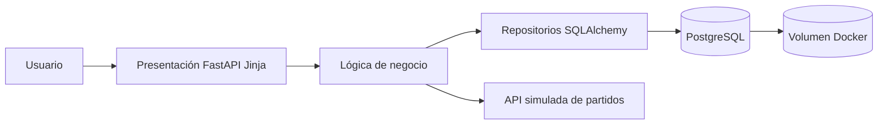
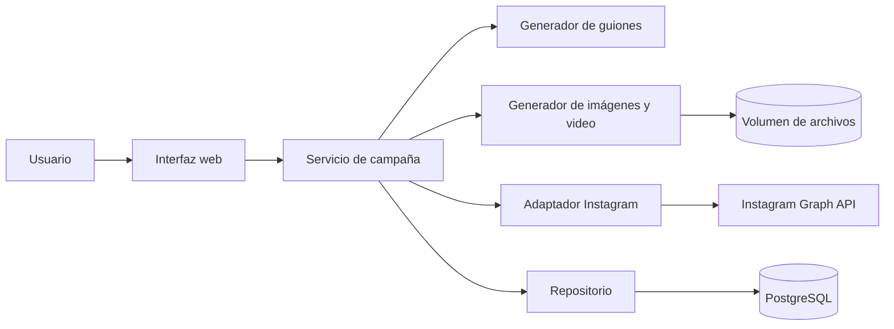

# Arquitectura y flujo de datos

## Pregunta 1

### Flujo de datos

1. Al iniciar el contenedor, la aplicación crea las tablas y consulta la API simulada.
2. La capa de negocio normaliza los partidos y solicita su almacenamiento al repositorio.
3. La presentación consulta los partidos persistidos y los muestra en la interfaz.
4. El usuario envía partido, participante, ganador o empate y marcador.
5. La lógica valida la coherencia del resultado con el marcador.
6. El repositorio guarda la predicción asociada al partido.
7. La presentación consulta y muestra todas las predicciones.

## Pregunta 2

### Flujo de datos

1. El usuario registra empresa, producto, público, objetivo y fotografía.
2. El servicio almacena la fotografía y crea tres guiones.
3. El usuario selecciona un guion.
4. El generador produce tres imágenes cuadradas y un video MP4.
5. Los recursos se guardan en un volumen y sus rutas en PostgreSQL.
6. El adaptador publica la primera pieza mediante Instagram Graph API o genera una confirmación simulada.

